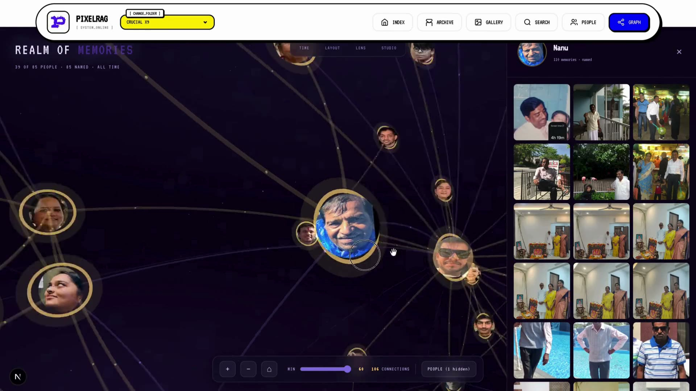
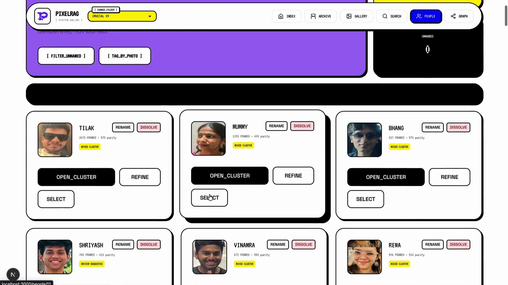
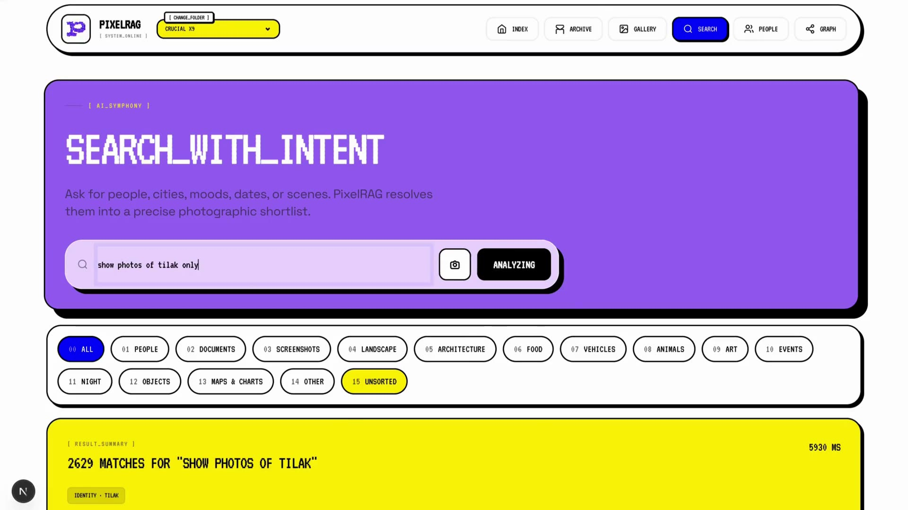
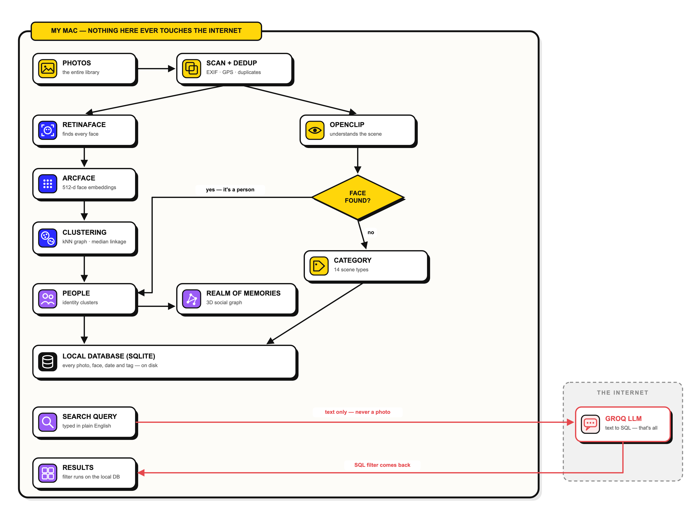

<div align="center">

# PixelRAG

**Your own Google Photos — running 100% on your machine.**

Face recognition, smart categories, natural-language search, and a 3D memory graph,
over a photo library that never leaves your disk.


</div>

---

## What it does

| | |
|---|---|
| **Natural-language search** | Type *"photos of Tilak from last winter"* — get exact results in seconds. |
| **Face recognition** | Every face detected and grouped into people, automatically. No manual tagging. |
| **Smart categories** | Documents, screenshots, landscapes, food, and more — sorted with zero training data. |
| **Realm of Memories** | A 3D graph of everyone in your photos and how they connect, year by year. |
| **Manage** | Share, export to folders, download as zip, delete — straight from search results. |

The only thing that ever touches the internet is your typed search query, sent to a Groq-hosted LLM purely to be translated into a database filter. **No photo is ever uploaded anywhere.**

## Screenshots

| Realm of Memories | People | Search |
|---|---|---|
|  |  |  |

## How it works



- **RetinaFace + ArcFace** find every face and turn it into a 512-d embedding
- **kNN graph + median-linkage clustering** groups thousands of faces into people in seconds
- **OpenCLIP** understands each scene and sorts photos into categories — no labels needed
- **Groq LLM** translates your typed query into a SQL filter (text in, filter out — that's all it sees)
- **SQLite** holds the whole index locally

## Getting started

You need **Python 3.10+** and **Node 18+**.

### 1. Clone

```bash
git clone https://github.com/tilakn21/pixelRAG.git
cd pixelRAG
```

### 2. Backend

```bash
python -m venv .venv && source .venv/bin/activate
pip install -r requirements.txt

cp pixel_rag_server/.env.example pixel_rag_server/.env
# open pixel_rag_server/.env and paste your free Groq API key

python -m uvicorn pixel_rag_server.main:app --port 8000
```

The first run downloads the AI models (~2 GB total). After that, everything is offline except search-query parsing.

### 3. Frontend

In a second terminal:

```bash
cd pixel_rag_web
npm install
npm run dev
```

### 4. Use it

Open **http://localhost:3000**, pick your photo folder, and hit **Sync**. Indexing runs fully hands-off — a large library takes a few hours the first time, and new photos only need a quick resync.

## Project structure

```
pixelRAG/
├── pixel_rag_core/      # the AI pipeline (Python)
│   ├── indexing/        #   scanning, dedup, EXIF, scene classification
│   ├── faces/           #   face detection, embeddings, clustering
│   └── query_engine.py  #   natural-language → SQL
├── pixel_rag_server/    # FastAPI backend (REST API on :8000)
│   ├── routers/         #   photos, search, identities, media, manage
│   └── services/        #   library manager, DB connection pool
└── pixel_rag_web/       # Next.js frontend (UI on :3000)
    └── src/             #   pages, components, API client
```

## Good to know

- Built and tested on **macOS (Apple Silicon)**. The pipeline itself is cross-platform; a few conveniences (like *Move to Trash*) are macOS-only.
- Works on external drives — point it at an SSD full of photos and it just indexes.
- The index database lives in `~/.pixelrag/`, so your photo folder is never modified.
